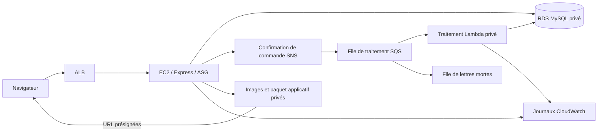

# VITALORA

Boutique de compléments alimentaires reposant sur une architecture AWS unique :
EC2 héberge l’interface et l’API synchrone, tandis que SNS, SQS et une fonction
Lambda privée assurent le traitement asynchrone des commandes.



## Prérequis

- Node.js 22 ou ultérieur et npm.
- Python 3.9 ou ultérieur.
- AWS CLI avec un profil IAM connecté et autorisé à déployer le projet.
- Terraform 1.10 ou ultérieur. En son absence, le script télécharge Terraform
  1.13.5 dans `.tools/` et vérifie sa somme de contrôle officielle.

Les autorisations du compte doivent permettre la création et la suppression
des ressources. Les modèles de permissions paramétrés figurent dans
[la documentation IAM](ops/iam/README.md).

## Déploiement en une commande

Pour un nouveau compte et une machine neuve, suivre d’abord
[le parcours de préparation](docs/new-account.md) : modèles IAM paramétrés,
initialisation explicite par le propriétaire et adresse de budget.
macOS/Linux sont pris en charge ; sous Windows, utiliser Ubuntu dans WSL2.
Remplacer `TEAM_PROFILE`, `ACCOUNT_ID` et `OWNER_EMAIL` par vos valeurs.

Depuis la racine du dépôt :

```sh
python3 scripts/deploy.py --profile TEAM_PROFILE --expect-account ACCOUNT_ID \
  --budget-alert-email OWNER_EMAIL --yes --verify
```

Le script compile l’application, exécute les tests locaux, initialise le stockage
de l’état, affiche le plan Terraform, déploie l’infrastructure et vérifie les
phases 1 à 5. Sans `--verify`, il attend seulement que le site et la base soient
prêts. Ajouter `--require-empty` permet de vérifier une reconstruction après
suppression complète de l’environnement applicatif.

Sans `--yes`, le script demande une confirmation après affichage du plan.
`--plan-only` s’arrête avant le déploiement applicatif ; l’initialisation peut
néanmoins créer le stockage indépendant de l’état s’il manque. Le script refuse
le profil root et peut vérifier le compte avec `--expect-account ACCOUNT_ID`.

Terraform ne possède pas de commande `build`. Le script regroupe la compilation
Node.js et les opérations Terraform. Le profil IAM doit être connecté et déjà
autorisé : cette commande ne configure pas les permissions d’un nouveau compte.
Le stockage de l’état et les éventuels audit et budget préexistants sont réutilisés.

Les étapes individuelles restent disponibles :

```sh
node scripts/build.mjs
npm test --prefix app
python3 -m unittest discover -s tests -p 'test_*.py'
python3 scripts/terraform.py --profile TEAM_PROFILE init
python3 scripts/terraform.py --profile TEAM_PROFILE plan -out=deployment.tfplan
python3 scripts/terraform.py --profile TEAM_PROFILE apply deployment.tfplan
python3 scripts/verify.py --profile TEAM_PROFILE
python3 scripts/verify-monitoring.py --profile TEAM_PROFILE
```

Le script utilise des identifiants temporaires actualisables via AWS CLI. Cela
permet aussi d’utiliser `aws login` avec le fournisseur Terraform actuel. Aucun
identifiant AWS n’est écrit dans les variables Terraform, le code ou les journaux.
Chaque compte possède son propre compartiment S3 d’état chiffré et versionné,
avec verrouillage natif S3.

Copier `envs/vm-based/terraform.tfvars.example` vers `terraform.tfvars` dans le
même dossier pour personnaliser le déploiement. Renseigner `budget_alert_email`
s’il n’existe aucun budget VITALORA dans le compte. Consulter
[le guide de reproduction](docs/reproducibility.md) avant de changer de compte.

## Phases 1 à 4

| Phase | Réalisation | Vérification |
| --- | --- | --- |
| 1 | Deux AZ, sous-réseaux publics/privés, ALB, modèle de lancement et ASG | `/health` et `/ready` accessibles via ALB |
| 2 | RDS privé chiffré, 40 produits et 40 images S3 privées | Requêtes API, images et lecture directe de la base |
| 3 | Catalogue, panier, commandes transactionnelles et idempotence | Total, stock, reprises HTTP et annulation d’une commande invalide |
| 4 | Boîte d’envoi persistante, SNS, SQS/DLQ et Lambda privée | Historique enregistré et journaux corrélés |

Au démarrage, l’application initialise le schéma et les données sous un verrou
de base de données. Les redémarrages conservent les stocks et les commandes.
Terraform provisionne les images et le paquet applicatif dans S3. Le navigateur
reçoit des URL présignées ; le compartiment reste privé.

Une transaction enregistre la commande, ses lignes, les modifications de stock
et l’événement en attente dans `outbox`. Le processus de publication sur EC2
réessaie toutes les deux secondes. Une panne SNS ne fait pas perdre l’événement
d’une commande validée. La livraison est au moins une fois : le traitement
Lambda utilise des transactions, des verrous et un historique unique pour
supporter les doublons.

Les valeurs techniques `received`, `confirmed`, `processing` et `shipped` restent
inchangées dans la base et l’API. L’interface affiche « Reçue », « Confirmée »,
« En préparation » et « Expédiée ». Les réponses partielles de lot isolent les
messages en échec ; après trois réceptions infructueuses, SQS les redirige vers
la DLQ.

## API et catalogue

| Méthode | Route | Rôle |
| --- | --- | --- |
| GET | `/health` | Disponibilité du processus |
| GET | `/ready` | Connexion à la base et contrôle de santé ALB |
| GET | `/products` | Catalogue et URL d’images présignées |
| GET | `/products/:id` | Détail d’un produit |
| POST | `/orders` | Création d’une commande, en-tête `Idempotency-Key` facultatif |
| GET | `/orders/:id` | Commande, lignes, total et historique persistants |

```json
{"customer_email":"demo@example.com","items":[{"product_id":1,"qty":2}]}
```

Les contrôles de prix et de stock sont effectués sur le serveur. Le catalogue
contient dix produits fictifs par catégorie : bien-être quotidien, nutrition
sportive, plantes et herbes, nutrition beauté. Les noms, descriptions et images
SVG sont en français. Les prix utilisent le format `fr-FR`.

Les paquets AWS SDK sont verrouillés à la version 3.1159.0. L’audit archivé du
29 octobre 2026 ne signalait aucune vulnérabilité connue. Recompiler avec
`node scripts/build.mjs` après une modification du code ou des dépendances.

## Sécurité et supervision

Les rôles EC2 et Lambda sont distincts. RDS reste privé et chiffré. Les images
S3 utilisent SSE-KMS avec une clé gérée par AWS et des clés de compartiment.
Les connexions RDS vérifient TLS avec le certificat officiel AWS fourni.
Root sert uniquement à l’initialisation explicitement autorisée des permissions.

CloudWatch reçoit les journaux structurés et propose un tableau de bord de six
widgets. Quatre alarmes surveillent le CPU EC2, les erreurs Lambda, les échecs
de traitement et les messages de la DLQ. La métrique des échecs de traitement
couvre les réponses partielles qui ne déclenchent pas forcément la métrique
Lambda `Errors`. Aucun destinataire e-mail d’alarme n’est configuré.

Le vérificateur injecte un enregistrement fictif invalide et attend une vraie
transition vers `ALARM`. Il contrôle aussi l’audit de gestion, le stockage privé,
le chiffrement et les notifications de budget à 20 %, 50 % et 80 % du montant
mensuel. Ces pourcentages ne représentent pas le solde de crédits promotionnels.

L’initialisation réutilise les ressources d’audit et de budget déjà présentes.
Sinon, le module de supervision les crée, sous réserve des autorisations et de
l’adresse de budget requises. Une nouvelle initialisation conserve la propriété
des ressources déjà gérées par Terraform. CloudTrail trace la gestion de
l’infrastructure ; RDS et CloudWatch conservent les événements métier.

## Budget et disponibilité

La démo utilise une instance EC2 `t3.micro` et une base MySQL 8.4 `db.t4g.micro`
dans une seule AZ. `desired_capacity = 2` active deux instances EC2. L’ALB couvre
deux AZ, et l’ASG remplace les instances défaillantes et peut monter à deux
instances. Les changements du modèle de lancement déclenchent un renouvellement.
Une base RDS Multi-AZ constitue une extension avec un budget supplémentaire.

Il n’y a ni NAT Gateway ni endpoint d’interface payant. EC2 utilise un sous-réseau
public avec accès applicatif uniquement depuis ALB ; SSH est désactivé par
défaut. Lambda n’a qu’un accès privé à RDS. Le service Lambda assure la lecture
SQS et l’envoi habituel des journaux. L’e-mail SNS est facultatif et nécessite
la confirmation du destinataire.

EC2 lit le mot de passe RDS dans SSM. Lambda le reçoit dans son environnement
chiffré. L’état Terraform contient des valeurs sensibles et reste dans le
stockage distant protégé. Consulter Budgets et Cost Explorer avant et après les
sessions : ALB, IPv4 publiques, EC2, RDS, stockage et journaux peuvent consommer
des crédits ou être facturés. Aucun montant final nul n’est certifié.

## Suppression de l’environnement

```sh
python3 scripts/terraform.py --profile TEAM_PROFILE destroy
```

Cette opération supprime l’application, la base et les images. Le stockage
indépendant de l’état et le socle d’audit/budget préexistant sont conservés.
Sauvegarder les preuves avant la suppression. Le guide de reproduction décrit
la [récupération automatique ciblée](docs/reproducibility.md#récupération-du-déclencheur-lambda)
d’un éventuel état résiduel de déclencheur Lambda. Le script conserve les
confirmations demandées par les options Terraform et écrit un bilan sans secrets
dans `test-results/cleanup.json`. Une séance déjà approuvée peut utiliser
`destroy -auto-approve`.

## Documentation et validation

- [Nouveau compte et nouvelle machine](docs/new-account.md).
- [Permissions de déploiement](ops/iam/README.md).
- [Cycle de vie et dépannage](docs/reproducibility.md).
- [Architecture](docs/architecture.md), [rapport](docs/project-report.md) et
  [scénario de démonstration](docs/demo-script.md).
- [État des fonctionnalités et limites](PROJECT_STATUS.md).

Le 2 novembre 2026, l’équipe a confirmé un déploiement réussi depuis une autre
machine dans un nouveau compte AWS indépendant. Le [compte rendu de reproduction](docs/evidence/2026-11-02-reproduction/README.md)
distingue cette confirmation des contrôles automatisés archivés.

Les résultats sous `docs/evidence/` sont des preuves datées, avec le périmètre
de chaque exécution. Ils ne sont pas des paramètres à copier dans un compte.
Chaque utilisateur doit effectuer ses propres vérifications fonctionnelles,
de suppression et de coût. Un plan valide ne remplace pas un test sur AWS.
