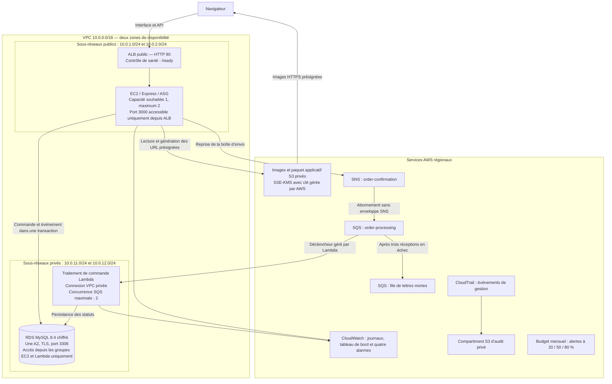
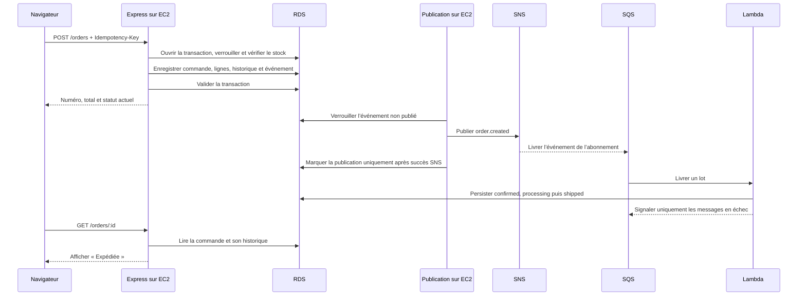

# Architecture VITALORA

Une seule application associe EC2 et Serverless dans `eu-west-3`. La démo utilise
une instance EC2 et une base RDS dans une seule AZ. ALB couvre deux zones de
disponibilité ; l’ASG peut atteindre deux instances. Le schéma décrit cette
configuration économique, sans prétendre déployer une base RDS Multi-AZ.

S3, SNS, SQS et la supervision sont des services régionaux, hors du VPC. La
connexion VPC de Lambda sert à joindre RDS. Le service Lambda gère la lecture
SQS et l’envoi habituel des journaux. Les sous-réseaux privés n’ont ni route
Internet par défaut, ni NAT Gateway, ni endpoint d’interface payant. EC2 dispose
d’un accès sortant public pour l’installation, les API AWS et Systems Manager.
SSH est désactivé par défaut.

La commande et l’événement en attente sont validés ensemble. La livraison SNS
est au moins une fois. Transactions, verrous et unicité de l’historique
permettent de gérer les doublons ; le transport n’est pas garanti exactement
une fois. Les statuts techniques de l’API restent en anglais et l’interface les
traduit en français.

Une extension de haute disponibilité utiliserait deux instances EC2 et RDS
Multi-AZ. Son coût supplémentaire doit être distingué de la configuration de
démonstration. La [reproduction dans un nouveau compte depuis une autre machine](evidence/2026-11-02-reproduction/README.md)
a été confirmée par l’équipe le 2 novembre 2026.
