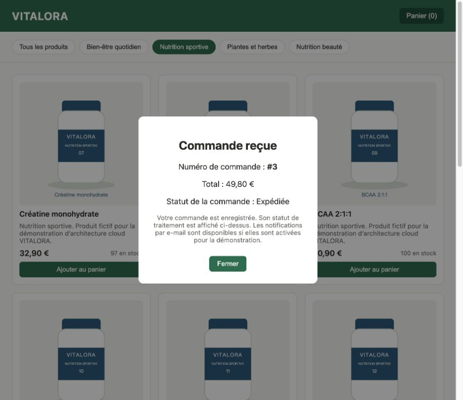

# Validation de la boutique française sur AWS

Le 29 octobre 2026, reconstruction depuis un état applicatif vide dans le
compte 573199225243, région eu-west-3, avec le profil IAM vitalora-deployer.

- [Déploiement](deployment.json) : compilation, tests, plan, création et vérifications.
- [Phases 1 à 4](phase-1-4.json) : ALB, 40 produits et images privées, stock,
  idempotence, annulation transactionnelle, RDS et journaux EC2/Lambda corrélés.
- [Phase 5](phase-5.json) : chiffrement, audit livré, budget, tableau de bord,
  quatre alarmes et vraie transition vers ALARM après une erreur contrôlée.
- [Interface française](interface.json) : HTML et JavaScript identiques aux
  sources, 40 noms et descriptions français conformes, commande navigateur 3
  avec deux articles et un total de 49,80 €, statut final « Expédiée ».
- [Empreintes des sources](source-hashes.json).

Le navigateur utilisait le véritable ALB et la base RDS, sans serveur simulé.
Cette validation couvre le compte actuel ; les autres comptes et le coût final
restent à vérifier. Les tests d’alarme ne simulent pas un cycle complet de DLQ.

## Suppression vérifiée

Les 96 ressources applicatives ont été supprimées. Le défaut Lambda 403 a été
récupéré automatiquement après deux contrôles d’absence, sans élargir IAM.
L’état est vide et les inventaires VPC, RDS, Lambda et SQS sont vides. Voir
[le bilan](cleanup.json) et [l’inventaire](inventaire-apres-suppression.json).
L’audit, le budget et le stockage d’état préexistants sont conservés.
