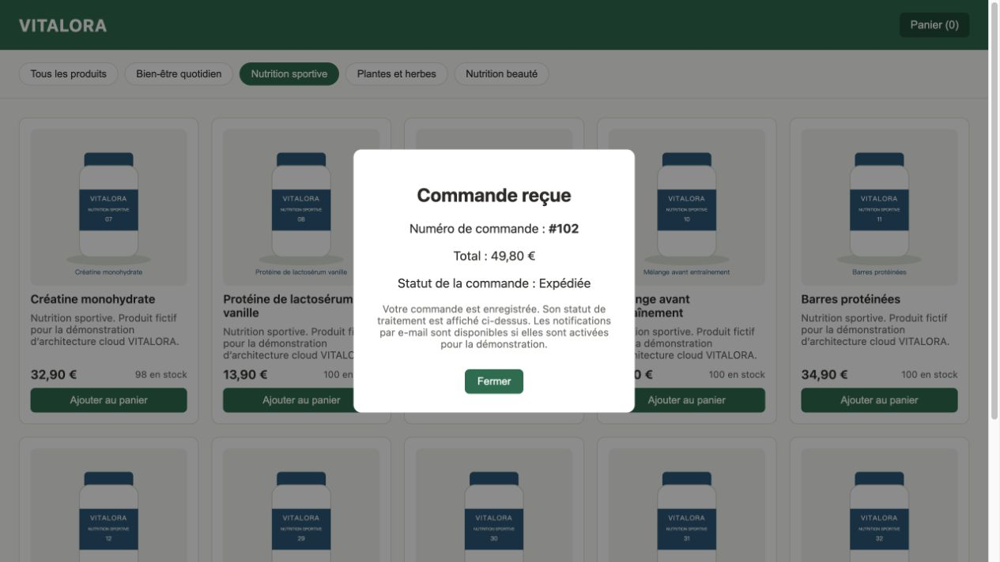

# Validation locale de la version française — 29 octobre 2026

La traduction couvre l’interface, les messages et statuts affichés, les montants
au format `fr-FR`, les 40 produits et images SVG, les textes des scripts, les
descriptions de supervision, la documentation et les dix diapositives.

Les identifiants API/SQL, codes d’erreur, noms de ressources et événements
structurés restent stables. Les preuves AWS historiques n’ont pas été modifiées.

- Neuf tests applicatifs et quatre tests de gouvernance réussis.
- Configuration Terraform valide et sources Python/JavaScript valides.
- Paquet partagé EC2/Lambda préparé avec les dépendances verrouillées.
- Quarante titres SVG correspondant aux noms français du catalogue.
- Navigateur : navigation du catalogue, panier entre deux catégories, total
  `49,80 €`, message de stock insuffisant et état final « Expédiée ».
- Après confirmation, le filtre « Nutrition sportive » reste sélectionné.

Le navigateur utilisait un serveur local avec données et traitement simulés.
La commande 102 et la capture ne proviennent ni de RDS ni d’un déploiement AWS.
Aucune nouvelle ressource AWS n’a été créée pour cette traduction.

Les détails et empreintes sont dans [verification.json](verification.json).

