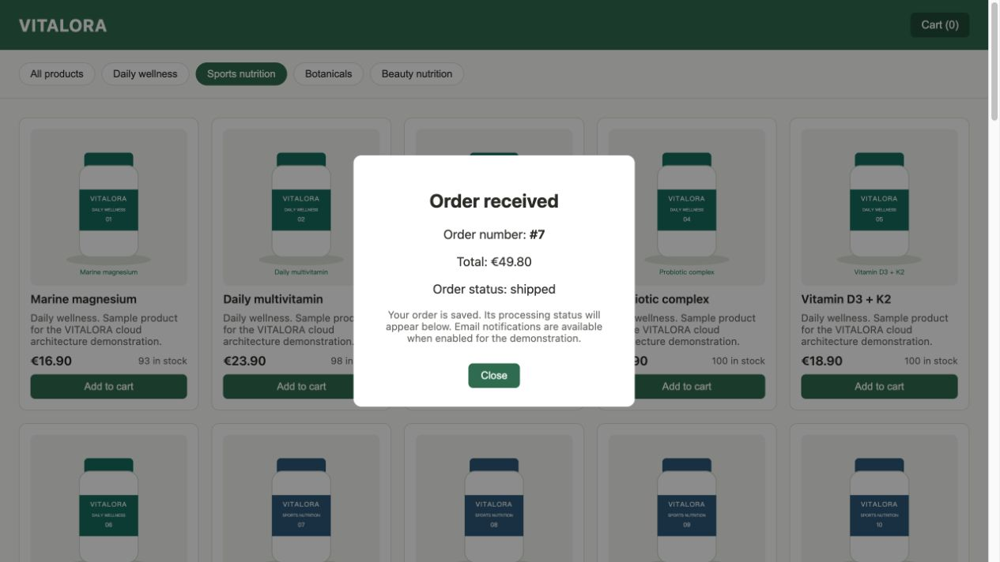

# Preuves AWS initiales — 29 octobre 2026

Compte : `573199225243`. Région : `eu-west-3`.
Les changements et vérifications ont utilisé le profil IAM de déploiement.

- [Phases 1 à 4](phase-1-4.json) : 40 produits et images, commande expédiée,
  historique persistant, lecture directe de la base et groupes de journaux.
- [Phase 5](phase-5.json) : stockage privé chiffré, budget, événement d’audit
  livré et vraie alarme de traitement.
- [Audit des dépendances](npm-audit.json) : aucune vulnérabilité connue à cette date.
- [Compilation et reproduction](verification.json) : versions, tests, empreintes
  du paquet et des verrouillages, limites de couverture des comptes.
- [Commande dans le navigateur](checkout.jpg) : commande fictive ayant atteint
  le statut d’expédition dans le premier environnement.
- [Suppression](cleanup.json) : premier environnement entièrement supprimé,
  ressources réseau Lambda libérées et état applicatif vide.

Ces preuves précèdent la traduction française. Les données JSON, noms de
produits et textes visibles de la capture restent dans leur langue d’origine.
Ils ne prouvent pas un déploiement de la nouvelle interface française. Seules
des métadonnées d’audit sélectionnées ont été conservées, sans identifiants AWS,
mot de passe, état Terraform ou plan sensible. Les adresses e-mail sont fictives.
La reproduction dans d’autres comptes n’est pas attestée.

